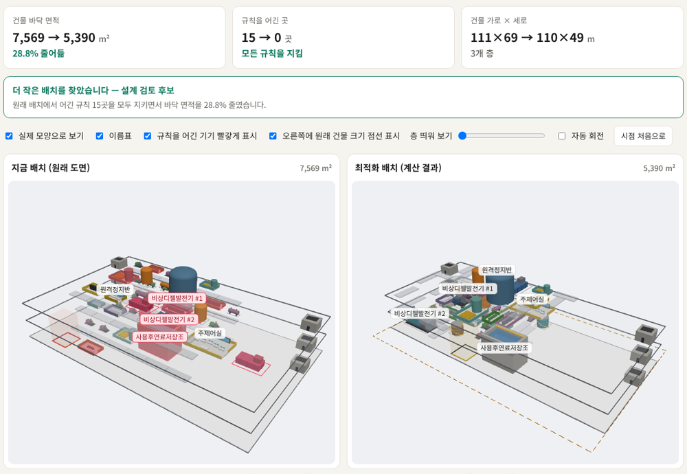

# SMR GA Layout Optimizer

> ## ⚠️ NOT FOR CONSTRUCTION — 개념검토용
>
> 이 도구의 산출물은 **개념검토(concept study)** 용이다. 시공·인허가 제출·상세설계에
> 그대로 쓸 수 없다. 모든 도면에 `NOT FOR CONSTRUCTION` 이 찍혀 나온다.
> 예제 파일의 치수·이격·제약 파라미터는 **전부 가정값**이며 실제 설계값이 아니다.
> 설계 책임은 유자격자에게 있고, **검토 대상은 도면이 아니라 IR** 이다.
> 그리고 **실제 SMR 설계값(치수·차폐·배치·보안)을 LLM 대화에 입력하지 말 것** — 한계 13항.

SMR·플랜트의 General Arrangement 배치를 최적화하는 Claude Code 플러그인 + MCP 서버 (Claude · ChatGPT · Codex).

### 3D로 보기 — 현황 vs 최적화

**[▶ 브라우저에서 3D 비교 열기](https://hajun011103.github.io/ga-layout-optimizer/)** — 예제 도면 4종의 원래 배치와 최적화 배치를
같은 축척 3D로 나란히 보여준다 (three.js, 설치 불필요). 페이지 소스: [`docs/index.html`](docs/index.html) ·
데이터 재생성: `python3 tools/make_viewer_data.py`.

[](https://hajun011103.github.io/ga-layout-optimizer/)

**도면을 넣으면 그 공간을 더 작게** 만드는 배치를 결정론적 솔버로 찾고, 현황 도면과 같은 기준으로 비교한다.
자연어 요구사항을 **Design Intent IR** 로 정형화하고, 사람이 승인한 IR 을 해시로 동결한 뒤,
**결정론적 솔버**가 배치를 계산해 SVG / DXF 도면을 만든다.

**LLM 은 좌표를 한 개도 생성하지 않는다.**

```
자연어 요구사항
   │
   ▼  LAYER 1 — LLM : 추출 · 되묻기 · 사전검증 제약 라이브러리에서 선택
Design Intent IR (JSON)
   │
   ▼  결정론적 규칙 검증기 (LLM 미사용)
╔══════════ GATE 1 : 사람 승인 ══════════╗
║ ERROR 0 이어야 통과. 승인 즉시 IR 동결 ║
║ 이후 전 과정은 LLM 호출 0회로 재현     ║
╚════════════════════════════════════════╝
   │
   ▼  LAYER 2 — 결정론적 솔버 (seed 고정)
Sequence-Pair 패킹 → SA 또는 NSGA-II 다목적
   │
   ▼  LAYER 3 — 결정론적 도면 생성기
SVG / DXF / JSON — 모든 치수는 IR 과 솔버에서만 온다
   │
   ▼  LAYER 4 — LLM : 읽기 전용 해설 · 트레이드오프 · 추적성 보고
```

이 구조는 우회로가 아니다. **10 CFR 50 Appendix B Criterion III** 가 설계검증 수단으로
"설계검토, **대안적 또는 단순화된 계산방법의 수행**, 시험"을 명시하고 있으므로,
LLM 산출물을 결정론적 솔버로 재계산해 검증하는 것은 **규정이 이미 기술해 둔 경로**다.

---

## v0.3 — 도면을 넣으면, 그 공간을 더 작게

```
도면 파일 (DXF · SVG · PDF · PNG · IFC · CSV/XLSX)
   │  결정론적 파서 — LLM 이 좌표를 읽지 않는다
   ▼
현황 배치 (Takeoff) ──────────────┐  인식 미리보기를 사람이 확인 (축척·분류)
   │                               │
   ▼  도면이 모르는 것은 질문으로   │
IR 초안: 기기·실 치수, 고정 장애물, │  "현재 공간" 외곽 = 넘을 수 없는 한계
         공간 우선(space_first)     │
   ▼  요건(연결·구역·이격) 반영 → Gate 1 → 사람 승인 → 동결
결정론적 솔버 (현황 배치에서 출발 + 다중 재시작)
   ▼
같은 목적함수로 현황 vs 최적화 채점 → 판정 · 도면 · 보고서
```

| 하고 싶은 것 | 무엇이 해 주나 |
|---|---|
| 아무 형식의 도면을 넣는다 | `engine/importers/` — DXF(R12~2018, 블록·해치·MTEXT·한글), SVG(transform·path), **벡터 PDF**(OCG 레이어·한글 ToUnicode·xref stream), **PNG 래스터**(벽으로 둘러싸인 실 인식), IFC(IfcSpace·기기 압출형상·층), CSV/XLSX/JSON 기기 목록. DWG·JPEG 는 변환 방법을 안내한다 |
| 그 공간 안에서 더 작게 | 현재 외곽 → `max_w/max_d` hard 한계, `preset: space_first`, 코어·기둥·격납은 `pinned` 고정 장애물(다른 블록이 피해 간다), 배치 금지 영역 `void` |
| 개선이 진짜인지 | 현황 배치를 **같은 IR·같은 목적함수**로 채점해 비교. 현황이 더 나으면 "현황 유지" 판정. 해에 hard 위반이 있으면 "채택 불가" |
| Claude 와 GPT 에서 쓰기 | `server/mcp_server.py` — 표준 라이브러리만 쓴 **MCP 서버**. stdio(Claude Code·Desktop·Codex) + Streamable HTTP(ChatGPT 웹·Claude.ai 커넥터) |
| 사람이 직접 쓰기 | `/studio` 브라우저 화면 — 업로드 → 인식 확인 → 요건 → Gate 1 승인 → 실행 → 현황 대비 비교 |

### 예제 — 원전과 비교군 (전부 가정값 · 합성 현황 도면)

`examples/drawings/` — `python3 tools/make_examples.py` 로 다시 만든다. 현황 도면은 사람이 그렸을 법한
관행 배치(복도형 2열, 파이프랙 양측 배치)를 **규칙으로 생성한 합성 도면**이고 요건 파일은 좌표 없는 패치다.

| 예제 | 형식 | 무엇이 어려운가 | 결과 (탐색량 normal, seed 20260826) |
|---|---|---|---|
| **원전** SMR 보조건물 3개 층, 44기기 | DXF (mm) | 화재분리 App.R, 해치 화재구역 병합, 다층 관통(SFP·RWST·해치), 터빈 미사일, 중요구역, 하중경로, 공지, 중력구동 표고, 크레인 | 현황 hard 위반 **15 → 0**, 건축면적 7,569 → 4,994 m² (**−34.0%**) |
| 비교군: 석유화학 공정 플랜트 | 벡터 PDF 1:500 | 가열로·압축기·탱크·제어실 화재/폭발 이격, 공정 배관, 고정 파이프랙 | 위반 **7 → 0**, 19,764 → 17,980 m² (**−9.0%**) |
| 비교군: FPSO 상부 2개 데크 | SVG | 위험구역↔거주구역 분리, 무게중심 편심, 고정 터렛·크레인 | 위반 **4 → 0**, 6,528 → 3,724 m² (−43.0%) |
| 비교군: 병원 수술부 | PNG 래스터 | 청결/오염 분리, 수술실-멸균코어 인접. **현황이 빈틈없이 꽉 찬 평면** | 위반 2 → 1 — **"채택 불가" 판정** (줄일 여지 없음) |

#### 기능 유지 최적화 (2026-11-01) — "줄이되 각 공간이 역할을 하게"

면적만 보고 줄이면 복도가 끊기고 실에 들어갈 수 없게 된다. 그래서 **고정은 없애고(계단 코어·배관대·크레인도 이동,
복도·배관대 구간은 삭제 가능) 대신 역할을 제약으로 지킨다** — 실 출입(`CIRC-ACCESS`), 동선 연결(`CIRC-CONNECT`),
피난(`EGRESS`), 배관대·크레인 공급(`RACK-SERVE`), 근거 있는 실 규모 계획(`program`). 요건과 근거:
[`examples/function/`](examples/function/README.md). thorough, seed 20260826.

| 사례 | 현황 위반 (엔진) | 이전 (면적만) | 같은 근사 검사: 현황 → 이전 결과 | **기능 유지** | 남은 위반 · 판정 |
|---|---|---|---|---|---|
| 원전 SMR 보조건물 (가상) | 69 | −34.0% | 60 → 71 | −47.4% | 동선 연결 4·외벽 2 — 채택 불가 |
| FPSO 상부 (가상) | 7 | −43.0% | 2 → 1 | **−60.2%** | **0** — 설계 검토 후보 |
| 병원 수술부 (가상) | 2 | −0.4% (위반 1) | 0 → 1 | **−12.6%** | **0** — 설계 검토 후보 (수술실 5개를 기준 크기로 축소 포함) |
| 석유화학 플랜트 (가상) | 9 | −9.0% | 3 → 8 | **−70.6%** | **0** — 단 배관대 30구간 중 24개 삭제, 도로 미반영(과대평가) |
| 의료·치과 클리닉 (**실제**) | 3 | −7.0% | 16 → 60 | −1.3% | 동선 연결 3·외곽 초과 1 — 채택 불가 |
| 연구소 (**실제**, KIT) | 0 | — | — | — (−6.6% 이지만 외곽 초과) | 현재 외곽을 넘음 — 현황 유지 |

- **현황 위반(엔진)** 은 원래 도면을 같은 요건으로 채점한 수다. 가상 SMR 은 합성 도면의 기기가 복도에 닿지 않아
  현황부터 69건이다 — 그러니 "이전 결과가 기능을 깼다" 는 비교는 **같은 검사로 잰 현황 대비** 로만 읽어야 한다
  (`tools/check_function_rules.py`, 계단 묶기·복도 분할을 하지 않는 근사라 엔진 수치와 다르다). 클리닉은 16 → 60 으로 뚜렷이 나빠졌다.
- 실제 클리닉의 실 면적은 현황에서 겹친 실을 잘라내며 **10.3% 줄어든 상태로** 배치된다 (`_resolve_overlaps`) — 축소율이 그만큼 유리하게 나올 수 있다.
- 2026-11-01 독립 검증(Fable)에서 나온 문제를 고친 뒤의 수치다: 계단 코어가 경계값에서 묶이지 않던 버그(이전 SMR "위반 0" 은 무효),
  접촉을 유지보수 이격 포함 외곽으로 재던 문제(이제 본체 기준), 수술실이 다른 실을 거쳐 들어가던 문제(`direct`), 위층 계단이 피난층까지 이어지는지 검사 추가.

이전 결과는 안전 이격·화재구역 같은 *안전 규칙* 은 지켰지만 *쓰임새*(출입·동선·피난)는 보지 않았다.
실제 평면 두 건과 가상 SMR 은 기능을 지키며 줄이는 해를 아직 찾지 못했다 — 복잡한 동선망을 다시 짜는 것은 지금 탐색(Sequence-Pair + SA)의 한계다.

#### 공개 실제 도면 시험 — 의료·치과 클리닉 (2026-11-01)

가상 예제만으로는 실제 도면에서 어떻게 되는지 알 수 없어서, **실제 건물의 공개 BIM**으로 돌렸다.
원전 평면도는 공개본(NuScale FSAR 1장 평면도 24장)에서 모두 *Withheld* 처리되어 쓸 수 없었다.

- 도면: Medical-Dental Clinic `Clinic_Architectural.ifc` (실제 건물, 정보 일부 비공개 처리) —
  BSI (2020) "Medical-Dental Test Files," buildingSMART International,
  [Community-Sample-Test-Files](https://github.com/buildingsmart-community/Community-Sample-Test-Files), CC BY 4.0.
  파일은 저장소에 넣지 않았다. `bench/real/public/clinic/` 에 받아 두면 `tools/make_viewer_data.py` 가 포함한다.
- 인식: IfcSpace 269개 중 실 259 + 뚫린 공간 1 + 지붕 면 6(제외), 계단 6, 3개 층(빈 기초층 제외). 약 3초.
- 결과(normal, seed 20260826, **요건 없이** 도면만): 바닥 면적 3,430 → 3,189 m² (**−7.0%**), hard 위반 0 —
  **대신 원래 붙어 있던 실들이 멀어졌다 (인접 비용 3.5배).** 인접 가중치를 10배로 올려도 −5.5%, 3.8배.
  지금 엔진은 실을 자유 직사각형으로 보고 전체를 다시 섞으므로 **실제 평면의 동선 구조를 유지하지 못한다.**
  실무에 쓰려면 실 간 인접·동선 요건(어떤 실끼리 붙어야 하는가)을 먼저 정의해야 한다.
- 실제 도면에서 처음 드러나 고친 것: 빈 IFC 층이 1층으로 끼어듦 · 벽의 창/문 구멍이 층 관통 개구부로 잡힘(403개) ·
  ROOF/OPEN TO BELOW 공간이 실과 겹침 · ㄱ·ㄷ자 실의 외접 사각형 합이 바닥 면적을 넘음(→ 같은 면적 직사각형) ·
  벽 두께로 겹친 실들(→ 맞닿은 면에서 잘라 냄, 면적 10.3%) · **현황 → Sequence-Pair 변환이 빽빽한 평면에서
  외피를 52×66 → 73×74 m 로 부풀림**(→ Murata 조건 그대로 구성, 현황보다 커지지 않음을 테스트로 보장).
  마지막 수정으로 가상 원전 예제도 −28.8% → −34.0% 로 바뀌었다.

> **⚠️ 이 개선율을 성과로 쓰지 말 것.** 현황 도면이 합성이고 관행적 여유 공간을 일부러 담았다.
> FPSO 의 −43% 같은 숫자는 합성 현황의 여유 때문이다. 병원 사례가 보여주듯 **꽉 찬 평면에서는
> 솔버가 개선을 지어내지 않는다.** 실제 기대치는 기존 연구대로 −10~15% 수준으로 본다.
> 원전 예제의 폭(110 m)이 줄지 않은 이유는 양 끝 계단 코어를 고정 장애물로 인식했기 때문이다 —
> 도구가 "정말 고정입니까?" 라고 묻는 이유다.

공개 원전 도면에 대해: NRC 공개 NuScale 문서에서 실제 평면도를 받아 시험했으나, 층별 배치도는
**비공개 처리(10 CFR 2.390)되었거나 선으로 그린 래스터**여서 CAD 기하가 없었다. 벡터 블록 다이어그램
(기능 경계도)에서는 RXB·CRB·RWB·TGB 건물 경계를 라벨까지 정확히 읽었다. APR1400 DCD 배치도는 전부 삭제본이다.

---

## 설치 · 연결

### 공통 — 요구사항

- **Python 3.8+ 만.** 엔진·파서·MCP 서버 모두 표준 라이브러리만 쓴다. `pip install` 할 것이 없다.

  ```bash
  conda create -y -n smr-ga python=3.11     # 서드파티 0개인 상태가 정상이다
  conda activate smr-ga
  python tests/run_all.py                    # 140 tests
  ```

  엔진에 서드파티 의존성을 추가하는 변경은 아래 폐쇄망 조항을 먼저 개정한 뒤에만 한다.
- **엔진은 외부 네트워크 불필요.** 폐쇄망에서 `git clone` 만으로 설치된다.
  단, **로컬인 것은 엔진뿐이다** — 어떤 LLM 클라이언트(Claude·ChatGPT)를 쓰든 도구 응답(기기 이름·치수·결과)은
  그 LLM 서비스로 전송된다. 실제 설계값을 넣지 말 것 (한계 13항).

### Claude Code — 플러그인 (MCP 서버 자동 등록)

```bash
git clone <이 저장소> smr-ga-plugin
# Claude Code 안에서
/plugin marketplace add ./smr-ga-plugin
/plugin install smr-ga@smr-ga-marketplace
```

| 명령 | 단계 |
|---|---|
| `/smr-ga:ga-layout` | 스킬 — 전체 진행 (도면 경로 / 자연어 경로) |
| `/smr-ga:ga-import` | 도면 → 현황 배치 → 프로젝트 |
| `/smr-ga:ga-spec` | 자연어 → IR 초안 |
| `/smr-ga:ga-check` | Gate 1 검증 + 동결 |
| `/smr-ga:ga-run` | 최적화 + 도면 |
| `/smr-ga:ga-explain` | 해설 (읽기 전용) |
| `/smr-ga:ga-studio` | 브라우저 스튜디오 + 원격 MCP 엔드포인트 |

플러그인의 [`.mcp.json`](.mcp.json) 이 MCP 서버 `smr-ga` 를 등록한다 (도구 18개, `ga_*`).

### Claude Desktop

`claude_desktop_config.json`:

```json
{ "mcpServers": { "smr-ga": { "command": "python3",
    "args": ["/절대경로/smr-ga-plugin/server/mcp_server.py"] } } }
```

### Codex CLI (OpenAI)

`~/.codex/config.toml`:

```toml
[mcp_servers.smr-ga]
command = "python3"
args = ["/절대경로/smr-ga-plugin/server/mcp_server.py"]
```

규약은 [`AGENTS.md`](AGENTS.md) 에 있다.

### ChatGPT 웹 · Claude.ai 웹 (원격 MCP 커넥터)

웹 서비스는 **공개 HTTPS 주소의 MCP 서버**만 붙는다. 이 컴퓨터에서 서버를 띄우고 터널로 연다.

```bash
TOKEN=$(python3 -c "import secrets;print(secrets.token_urlsafe(24))")
cloudflared tunnel --url http://127.0.0.1:8765          # → https://<무작위>.trycloudflare.com
python3 server/mcp_server.py --http --port 8765 --token "$TOKEN" \
        --public-url https://<무작위>.trycloudflare.com
```

| 서비스 | 등록 위치 | 입력할 URL |
|---|---|---|
| ChatGPT (개발자 모드) | 설정 → 앱·커넥터 → 고급 → 개발자 모드 켜기 → 커넥터 만들기 · 인증 "없음" | `https://<무작위>.trycloudflare.com/t/<TOKEN>/mcp` |
| Claude.ai | 설정 → 커넥터 → 사용자 지정 커넥터 추가 | 같은 URL |

- 토큰은 URL 경로(`/t/<TOKEN>/…`) 또는 `Authorization: Bearer` 로 검사한다. **URL 을 아는 사람은 누구나 쓸 수 있으니** 쓰고 나면 서버와 터널을 끈다.
- 웹 LLM 은 사용자 컴퓨터 파일을 서버에 직접 넘기지 못한다 → `ga_upload_link` 가 주는 **스튜디오 업로드 페이지**에서 올리고, 나온 `file_id` 를 대화에 붙여 넣는다. 다운로드 URL 이 있는 파일은 `url` 인자로 바로 넘길 수 있다.
- 원격 모드에서는 서버 로컬 경로 읽기가 기본으로 막혀 있다 (`--allow-local-paths` 로만 허용).
- ★ **원격 연결 = 도면과 결과가 OpenAI/Anthropic 서비스로 전달된다.** 폐쇄망·실제 설계값에는 쓰지 말 것.
  각 서비스의 메뉴 이름과 요금제별 제공 여부는 바뀔 수 있다 — 연결이 안 되면 해당 서비스 도움말의 "MCP 커넥터" 항목을 확인할 것.

### 브라우저 스튜디오 (LLM 없이)

```bash
python3 server/mcp_server.py --http      # → http://127.0.0.1:8765/studio
```

스튜디오는 LLM 클라이언트와 **같은 MCP 도구**를 호출한다. 오른쪽 패널에 호출 기록이 남는다.

---

## MCP 도구 (18개)

| 도구 | 하는 일 | 쓰기 |
|---|---|---|
| `ga_supported_formats` · `ga_upload_link` | 형식·전달 방법 안내 | |
| `ga_import_drawing` | 도면 → 현황 배치 + 인식 미리보기 SVG | ✓ |
| `ga_create_project` | 현황 → IR 초안 + asis.json + **확인 질문** | ✓ |
| `ga_create_project_from_ir` | 자연어 경로 (좌표 필드 거부) | ✓ |
| `ga_list_examples` · `ga_load_example` · `ga_apply_example_requirements` | 내장 예제 | ✓ |
| `ga_get_ir` · `ga_update_ir` | IR 조회 · 비좌표 필드 패치 (근거 `reason` 필수, 편집 시 동결 해제) | ✓ |
| `ga_validate` | Gate 1 결정론적 검증 | |
| `ga_freeze` | **사람 승인** 후 IR 동결 (`approved_by` 필수) | ✓ |
| `ga_optimize` · `ga_run_status` | 동결된 IR 로만 실행 · 진행/결과 | ✓ |
| `ga_get_drawing` · `ga_explain` · `ga_floor_sweep` · `ga_constraint_catalog` | 도면·해설용 사실·층수 스윕·제약 카탈로그 | |

도구가 강제하는 규칙: 좌표(`x`·`y`·`fixed_xy`)는 대화로 넣거나 바꿀 수 없다 · 동결 안 된(또는 동결 후 바뀐) IR 로는
실행 거부 · 결과는 `{IR 해시, seed, 엔진 소스}` 로 캐시되어 같은 입력은 같은 결과 해시 · 가중치 패치는 병합되고
층고·외곽이 바뀌면 hard 가중치를 다시 산정(낮추지 않음).

---

## 바로 해보기

```bash
cd smr-ga-plugin

# 1) 검증 (Gate 1)
python3 engine/validate_spec.py examples/spec_smr_aux.json

# 2) 동결
python3 engine/validate_spec.py examples/spec_smr_aux.json --freeze

# 3) 최적화 + 도면
python3 engine/run.py examples/spec_smr_aux.json --iters 60000 --restarts 6

# 층수 민감도 스윕
python3 engine/run.py examples/spec_smr_aux.json --sweep-floors 1-6

# 다목적 Pareto — 가중치를 미리 정하지 않는다
python3 engine/run.py examples/spec_smr_aux.json --mode nsga --pop 80 --gens 80

# 음성 대조군 — 이 명령은 반드시 거부되어야 한다 (종료코드 1)
python3 engine/run.py examples/spec_infeasible.json
```

### 예제 결과 (`examples/spec_smr_aux.json`, 44블록 · 3층 · seed 20260826)

| 항목 | 기준안(수작업식 행 배치) | 최적화 |
|---|---|---|
| 외피 | 88.0 × 37.0 × 32.0 m | 51.0 × 45.8 × 32.0 m |
| 건축면적 | 3,256 m² | 2,336 m² |
| 건물체적 | 104,192 m³ | 74,746 m³ |
| hard 제약 위반 | 다수 | **0건** |
| 소요 | — | 206 s (60,000 iter × 6 restart) |

> **⚠️ 이 개선율을 성과로 제시하지 말 것.**
> 기준안이 나이브하다 (입력 순서대로 줄 세운 배치). **실제 기대치는 −10~15%** 다.
> 의미 있는 숫자는 개선율이 아니라 **hard 제약 위반 0건** 쪽이다.

---

## 무엇이 들어 있나

### 제약조건 라이브러리 (원전 고유, 10종)

LLM 은 여기서 **선택**만 하고 파라미터를 채운다. 수식을 발명하지 않는다.

| ID | 제약 | 근거 |
|---|---|---|
| `FIRE-20FT` | 화재방호 계열 분리 | 10 CFR 50 App. R III.G.2 (20 ft = 6.096 m). **이 값이 GA 의 실질 그리드 모듈이다** |
| `FIRE-HATCH` | ★ 해치·계단에 의한 화재구역 병합 | RG 1.189 Rev.5 |
| `TURBINE-25` | 터빈 미사일 금지 부채꼴 (±25°, 방위각이 이산 결정변수) | RG 1.115 |
| `SEISMIC-GAP` | 건물 간 이격 — 고정 수치가 아니라 성능식 | SRP 3.7.2 |
| `HELB-DIST` | 고에너지배관파단 — 거리에 의한 분리가 규제상 1순위 | BTP 3-3 |
| `TALL-EQUIP` | 다층 관통 기기 (관통부 정렬) | — |
| `FREE-AREA` | 공지 제약 (작업공간 / 비상공간) | Ejeh 2019 |
| `LOAD-PATH` | 안전하중경로 — 단일 낙하가 중복 트레인을 동시 무력화 금지 | NUREG-0612 §5.1.1 |
| `VITAL-AREA` | 중요구역 집약 + 2중 방벽 | 10 CFR 73.55(e)(9) |
| `ELEC-SEP` | 전기계통 물리적 분리 — **기본값 없음. 원문 대조 강제** | GDC 17 / RG 1.75 Rev.3 |

`FIRE-HATCH` 는 선행 프로토타입이 전혀 잡지 못하던 항목이다. 반출 해치·계단이 서로 다른
화재구역에 걸치면 **양쪽이 하나의 화재구역으로 병합되어** 분리 요건이 무효가 된다.
SMR 모듈 반출로는 화재구역 설계와 **동시에** 풀어야 한다.

전체 카탈로그: [`skills/ga-layout/references/constraint-library.md`](skills/ga-layout/references/constraint-library.md)
(코드에서 자동 생성 — `python3 engine/gen_docs.py --write`)

**2차 범위 (미구현, 후속 확장):** 다수호기 동시영향(IAEA SSR-2/1 Req.17 — SMR 다수모듈의
핵심 국제요건이나 부지배치 문제라 1차 제외) · 내부침수 분리(SRP 3.4.1/3.4.2) ·
항공기 충돌 기능분리(10 CFR 50.150) · 격납 격리밸브 검사공간(GDC 57) ·
토네이도 미사일(RG 1.76) · A\*/Dijkstra 라우팅 사후검증. 한계 2·5항 참조.

### ★ 사용금지 규제 수치 5건

[`regulatory-numbers.md`](skills/ga-layout/references/regulatory-numbers.md) 에 문서화되어 있고,
`engine/constraints.py` 의 `scan_forbidden()` 이 코드에서도 막는다.

1. 전기계통 이격 **"수평 3 ft / 수직 5 ft"** — RG 1.75 Rev.3 에는 수치가 없다. IEEE 384-1981 관행값.
2. 건물 간 이격 **고정 수치** — SRP 3.7.2 는 성능식이다.
3. **방사선구역 번호 체계** 하드코딩 — RG 8.8 이 구역 번호를 일절 언급하지 않는다.
4. 격리구역 폭 **"20 ft"** — §73.51(ISFSI) 조항이다. §73.55 에는 폭 수치가 없다.
5. **Safeguards Information** — 슬롯만 두고 값은 보안등급 자료에서 주입한다.

### 목적함수 (9항 + 제약 라이브러리)

체적 · 연결비용 · 방사선구역 분산(RZDI) · 물리적 분리 · 외벽 접면 · 크레인 커버리지 ·
외피 형상비 · 질량 편심 · **중력구동 표고 순서(SMR 고유)**.
→ [`objective-terms.md`](skills/ga-layout/references/objective-terms.md)

**가중치 자동 점검**: hard 페널티가 "1 m 를 양보해 얻는 한계이득"의 10배 미만이면 경고한다.
이 함정은 실제로 발생했다 — 프로토타입에서 크레인 가중치를 올리기 전까지 최적해가
크레인 베이를 **1.9 m** 벗어나 있었고, 다른 해에서는 RCA 출입통제가 외벽에서 **0.10 m**
떠 있었다. **둘 다 도면상 정상으로 보인다.**

### 알고리즘

- **표현**: 층별 Sequence-Pair (Murata et al., IEEE TCAD 1996).
  겹치는 배치를 **생성할 수 없으므로** 중첩 페널티가 필요 없고 탐색공간 전체가 실현가능하다.
  유지보수 이격은 블록 치수를 `clearance` 만큼 팽창시켜 흡수한다.
- **탐색**: SA + 다중 재시작 (`--mode sa`) 또는 **NSGA-II 3목적** (`--mode nsga`).
- **계층분해** (`--mode hierarchical`): ① 구역 배정 → ② 층·표고 배정 → ③ 층내 상세배치.
  정확해 MILP 는 25기기에서 이미 무너진다(갭 11.8%). SMR 보조건물은 수백 개 규모다.
- **층수 민감도 스윕** (`--sweep-floors`): 층수-비용 트레이드오프 곡선.
  근거: Ejeh 2019 요소플랜트 1층 260,942 → 4층 117,431(−55.0%). **층수를 고정하면 이 개선 여지가 사라진다.**

### 재현성

```
동일 IR 해시 + 동일 seed  →  동일 결과 해시
```

`out/run_manifest.json` 에 `{ir_sha256, seed, engine_version, result_sha256}` 가 기록된다.
`tests/test_determinism.py` 가 이 성질을 강제한다.

### 검증

```bash
python3 tests/run_all.py          # 전체
python3 engine/bench_qap.py --selftest    # 최적성 갭 (n<=8 전수탐색 대조)
```

- **1단계** QAPLIB — 공개 최적해와의 갭. 12건을 `tests/data/qaplib/` 에 동봉했다.
  n≤19 는 갭 **0.00%**, n=20~36 은 **0.16~5.37%** (100000×5, seed 20260826).
  예산을 50000×3 으로 줄이면 chr25a 갭이 23.9% 까지 벌어진다 — n≥25 에서는 예산이 결과를 좌우한다.
  외부 데이터가 없어도 n≤8 전수탐색 자체 인스턴스로 갭을 보고한다(**0.000%**).
  QAPLIB 는 **탐색 기계장치**만 검증한다 — 배치 목적함수의 정당성이 아니다.
- **2단계** Wrigley 2019 Shearon Harris (CC BY 4.0, `tests/data/wrigley2019/` 동봉) —
  `engine/bench_wrigley.py` 가 RCP 를 원자력섬에 고정하고 20개 모듈의 **층과 자리를 모두** 배정한다.
  논문의 제외 규칙(RCS↔안전계통 연결 제외)을 따르면 한 면 4층 **6,793**, 한 면 3층 **7,046** —
  논문 기준안 14,914 대비 −54.5% / −52.8%, 논문 최적 8,036(−46.1%)보다 낮다 (seed 3개에서 같은 값).
  **다만 같은 문제라고 단정할 수 없다** — RHR·SIS 를 격자에 둘지, RCP 위치, 거리 정의가 논문 본문에만 있고
  확인한 것은 공개 미리보기뿐이다. 두 면 배치(−33.9/−37.8%)는 모듈 묶음 정보가 없어 SKIP.
  (v0.2 변환기는 DSM 의 상삼각만 읽고 층 배정을 고정했다 — 그때의 −19.6% 는 쓰지 말 것.)
- **2단계** Ejeh 2019 다층 공정 플랜트 (`tests/data/ejeh2019/`, 부록 B 표 — PDF 원문과 전수 대조, 불일치 0) —
  `engine/bench_ejeh.py` 가 논문 목적함수(식 10: 배관·펌핑·층 건설·땅값)와 조건(후보 바닥 크기, 최소 이격, 90° 회전,
  관통·돌출 기기, LNG 적층·1층 50%/최상층 60% 공지)을 그대로 두고 이 엔진의 표현·SA 로 푼다. 판정은 독립 검사.
  100000×4, seed 5개 (층 수 스윕은 60000×3, seed 3개):

  **갭 = 논문 정답보다 비싼 정도 (낮을수록 좋고 0% 가 정답).** 기존 도면 없는 백지 배치 문제라 '얼마나 줄였나' 가 아니라
  '엔진이 진짜 최선에 얼마나 가까이 가나' 를 잰다. 증명된 최적보다 싼 답은 나올 수 없다.

  | 플랜트 | 기기 | 논문 | 실현가능 | 최고 갭 | 중앙 갭 |
  |---|---|---|---|---|---|
  | 요소 | 8 | 117,431.0 (증명된 최적) | 5/5 | **+1.48%** | +6.19% |
  | CDU | 17 | 592,322.2 (증명된 최적) | 5/5 | +15.04% | +19.54% |
  | LNG | 22 | 1,466,654.2 (논문도 2.2% 갭) | 5/5 | +14.36% | +21.60% |
  | COGP | 25 | 255,320.4 (논문도 11.8% 갭) | 5/5 | +39.64% | +40.74% |

  가용 층 수 스윕(최고 갭): 요소 1–4층 +0.17 · +12.88 · +3.52 · +6.19% — CDU 1–7층 +2.97 · +5.46 · +8.03 · +7.08 ·
  +13.22 · +12.39 · +17.95%. **증명된 최적보다 싼 해는 한 번도 나오지 않았다**(비용식·조건 구현의 하한 검사, 테스트로 고정).
  기기가 많아질수록 갭이 커진다 — COGP 는 바닥을 20×15 m 로 잡아 논문(20×10 m)보다 땅값·층 면적비가 약 9만 rmu 더 든다.
  후보 크기가 5 m 계단이라 비용이 계단식인 것이 SA 에 불리하다; 연속 면적 안내 항을 시험했지만 seed 편차보다 효과가 작아 쓰지 않았다.
  "LNG 바로 위" 는 이 구현의 해석(한 층 위에서 시작, 아래 기기 평면이 위 기기 평면 안). COGP 최소 이격은 논문에 언급이 없어 0.
- 2DPackLib — 데이터를 넣으면 활성 (현재 SKIP)
- **음성 대조군** `examples/spec_infeasible.json` — 실현 불가능한 요구사항 집합에
  "불가능"이라고 답하는지 확인한다. **LLM 파이프라인은 유창하게 실패한다.**

---

## 한계 — 반드시 알고 쓸 것

1. **NOT FOR CONSTRUCTION.** 개념검토용이다. 예제의 모든 수치는 가정값이다.
2. **단일 외피 패킹이다.** 엔진은 건물 하나의 내부를 푼다.
   **다건물 부지배치(건물 간 배치)는 미구현**이다. 따라서 `SEISMIC-GAP` 은 구현·시험되어
   있지만 단일 건물 예제에서는 적용 대상이 없다. 부지배치는 계층분해 1단계의 상위 문제다.
3. **다층 관통부 정렬은 (v0.3 부터) 구조적으로 보장된다.** 위층 점유를 순열로 따로 배치하지 않고
   기준층 좌표를 고정 장애물로 박아 넣는다. 이전 버전에서는 페널티로 처리해 0.10 m 잔차가 남았다.
   `TALL-EQUIP` 은 여전히 검사하며, 지붕을 뚫는 기기는 Gate 1 이 ERROR 로 막는다.
4. **Sequence-Pair 패킹은 빈 공간을 만들지 않는다.**
   압축 배치가 항상 생성되므로, 큰 이격을 실현하려면 **그 사이를 채우는 실체**
   (통로·차폐벽·공지 블록)가 IR 에 명시되어야 한다. 없으면 최적화기는 페널티를 내고
   붙여 놓는 해를 낸다. 실제로 `examples/spec_minimal.json` 의 MS↔주제어실 12 m 이격은
   `SHIELD`(차폐벽 겸 통로) 블록을 넣기 전까지 어떤 seed 로도 만족되지 않았다.
   물리적으로도 그 12 m 는 빈 공간이 아니라 차폐벽이다 — **IR 이 현실을 덜 담고 있었던 것**이다.
   Gate 1 이 이 상황을 WARN 으로 알려준다(요구 이격이 어떤 단일 블록보다 클 때).
5. **거리는 직교/유클리드 대리모형이다.** 실제 배관 라우팅은 이보다 길다.
   원저자들도 이를 명시했다 — **편향의 방향을 알고 쓸 것.**
   실제 동선 기반 거리(Dijkstra)와 A* 라우팅 검증은 미구현이다.
6. **선량·차폐 계산이 없다.** 방사선구역 항은 순수 기하량(분산)이며 차폐비용의 대리지표다.
7. **IFC/BIM 출력이 없다.** DXF R12 까지다. 외부 라이브러리 의존을 추가하려면
   폐쇄망 설치 가능성을 먼저 확인해야 한다.
8. **기존 BIM 모델 편집 기능은 의도적으로 만들지 않았다.**
   BIM-Edit 324개 IFC 편집 과제에서 최고 모델 평균 49.5%, **완전 해결 3.4%** 다.
9. **메타휴리스틱이므로 최적성 보증이 없다.** 갭을 보고할 수 있는 것은 QAPLIB 단계뿐이고 (n=20~36 에서 최대 5.4%),
   그것도 **탐색 기계장치**를 검증할 뿐 배치 목적함수의 정당성을 검증하지 않는다.
10. **진화·튜닝된 휴리스틱은 튜닝한 분포에만 맞는다.**
   FunSearch 가 진화시킨 빈패킹 휴리스틱은 다른 분포에서 Best Fit 보다 약 20배 나빴다.
   한 노형·한 부지의 데이터로 튜닝한 배치 휴리스틱을 다른 노형에 그대로 쓰지 말 것.
   이것은 NQA-1 의 **적용 범위(range of validity)** 정의 문제와 정확히 같다.
11. **국내 규정 조문 대조 미완.** KINS 심사지침은 NUREG-0800 SRP 와 동일 장·절 체계이므로
    대조 가능하지만, 원문 대조가 완료되지 않았다. 조직 표준 확정 전에 반드시 대조할 것.
12. **LLM 등급 분류.** 이 도구의 LLM 부분은 **비안전등급 생산성 도구**다.
    비결정론적이고 버전마다 출력이 바뀌는 LLM 을 안전등급 설계계산 도구로 지정(dedication)하는
    것은 현 실무상 불가능에 가깝다. 출력은 100% 사람과 결정론적 도구의 검증을 거쳐야 한다.
13. **로컬인 것은 엔진뿐이다.** Claude Code 의 LLM 레이어(요구사항 추출·해설)는 대화 내용이
    외부 상용 API 로 전송된다. **실제 SMR 설계값(치수·차폐·배치·보안)을 LLM 대화에 입력하지
    말 것 — 공개값·가정치만 허용한다.** 실데이터 적용은 폐쇄망 LLM(자체 호스팅) 경로가 필요하다.
    원격 MCP(ChatGPT 웹·Claude.ai)로 연결하면 도구 응답까지 해당 서비스로 간다.
14. **도면 인식은 외접 사각형이다.** 직사각형이 아닌 실·기기는 외접 사각형으로 근사하고 경고한다
    (채움률 표시). 곡선 벽·사선 배치는 정확히 표현되지 않는다.
15. **PNG 는 문자를 읽지 않는다(OCR 없음).** 실 이름은 RM001… 로 붙고, 이름·용도는 사용자 답변으로
    IR 에 넣는다 (좌표가 아니므로 허용). 스캔·사진 도면은 벽선이 끊기면 실이 합쳐진다 — `close_gaps_px`.
16. **래스터 PDF 는 벡터로 읽히지 않는다.** CAD 가 선을 래스터처럼 출력한 PDF(공개 NRC 문서 다수)는
    수십만 개 짧은 선으로 나와 실을 만들지 못한다 — 경고가 뜬다. PNG 로 변환해 넣을 것.
17. **빈틈없이 꽉 찬 평면은 Sequence-Pair 압축이 현황을 정확히 재현하지 못할 수 있다.**
    솔버는 현황 배치에서 출발(warm start)하지만, 결과가 현황보다 낫지 않으면 "현황 유지" 또는
    "채택 불가" 로 판정한다 — 개선을 지어내지 않는다 (병원 예제).
18. **가늘고 긴 실(형상비 5 이상)은 복도로 보고 구간으로 나눈다** (면적 보존). 복도 위치를 유지해야
    하면 해당 구간을 고정(`pinned`)하거나 `split_corridors: false` 로 만든다.
19. **현황 비교의 공정성은 IR 에 달려 있다.** 도면에는 연결·구역·이격 요건이 없다. 요건 없이
    줄이면 현황보다 '나쁜' 배치가 작게 나올 수 있다 — 그래서 도구가 질문을 먼저 한다.

---

## 실제 적용 전에 필요한 것

- 실제 기기 목록·치수 (예제는 전부 가정값)
- 건축·배관 단가 — 원가 효과를 말하려면 필요하다
- IEEE Std 384 최신판 — `ELEC-SEP` 파라미터가 이것 없이는 채워지지 않는다

## 라이선스

Apache-2.0. 벤치마크 데이터는 각 출처의 라이선스를 따른다
(Wrigley 2019 Shearon Harris 데이터셋은 CC BY 4.0, QAPLIB 는 Burkard·Karisch·Rendl 1997 공개 배포본).
