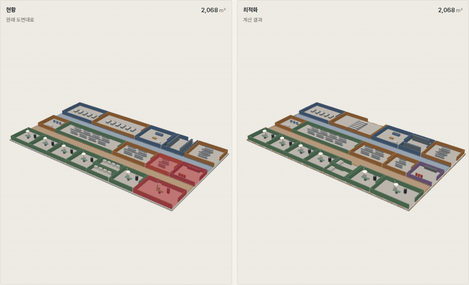
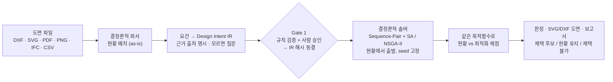

# GA Layout Optimizer

**도면을 넣으면, 각 공간의 역할을 지키면서 더 작게.**
건물·플랜트의 배치 계획(General Arrangement)을 결정론적 솔버로 다시 짜고, 원래 도면과 같은 기준으로 비교한다.
Claude Code 플러그인 + MCP 서버(Claude · ChatGPT · Codex) + 브라우저 스튜디오. Python 표준 라이브러리만 쓴다.

> **English summary.** GA Layout Optimizer takes an existing drawing (DXF, SVG, vector PDF, PNG, IFC, or an equipment table),
> recognises the as-is layout, and searches for a smaller layout in which every space still works — rooms stay reachable,
> corridors stay connected, egress distances hold, pipe racks and cranes still serve their equipment. Requirements are
> formalised as a JSON *Design Intent IR* with cited sources, frozen after human approval, and solved by a deterministic
> Sequence-Pair / simulated-annealing engine; the LLM never generates a single coordinate. The as-is layout is scored with
> the same objective, so the tool reports "keep as-is" or "not adoptable" instead of inventing an improvement. Example
> domains: petrochemical plant, offshore FPSO topside, hospital surgical suite, a nuclear auxiliary building, and two real
> public BIM models (a medical-dental clinic and a research institute). Concept-study use only — NOT FOR CONSTRUCTION.

[](https://hajun011103.github.io/ga-layout-optimizer/)

<sub>왼쪽은 원래 도면, 오른쪽은 같은 실들이 출입·동선·이격 요건을 지키며 새 자리로 옮겨 가는 과정 (병원 수술부, 2,068 → 1,808 m²).</sub>

**[3D 로 직접 돌려 보기 →](https://hajun011103.github.io/ga-layout-optimizer/)** 사례 6건과 벤치마크를 브라우저에서 돌려 보고, "변형 재생" 으로 배치가 바뀌는 과정을 볼 수 있다. 설치 필요 없음.

> **NOT FOR CONSTRUCTION — 개념검토용.** 산출물은 시공·인허가 제출·상세설계에 그대로 쓸 수 없고,
> 예제의 치수·이격·제약 파라미터는 전부 가정값이다. 설계 책임은 유자격자에게 있다.
> 그리고 **실제 설계값을 LLM 대화에 입력하지 말 것** — 로컬인 것은 엔진뿐이다 ([한계](guide/LIMITATIONS.md) 18항).

## 무엇을 하나

- **도면을 읽는다.** DXF · SVG · 벡터 PDF · PNG(래스터) · IFC · CSV/XLSX 에서 실·기기의 위치와 크기를 결정론적 파서로 읽고,
  인식 미리보기를 사람이 확인한다. LLM 은 좌표를 읽지도 쓰지도 않는다.
- **공간마다 필요한 기능을 요건으로 적는다.** 실 출입·동선 연결·피난·배관대/크레인 공급·실 규모 기준을
  공개 기준(IBC · ADA · FGI · ASR · 10 CFR 50 등)에서 찾아 근거와 함께 IR 에 넣는다. 근거가 없는 실은 줄이지 않는다.
  모르는 값은 지어내지 않고 사용자에게 묻는다.
- **기능을 지키며 더 작게 만들고, 정직하게 판정한다.** 사람이 승인해 해시로 동결한 IR 을 결정론적 솔버(Sequence-Pair + SA / NSGA-II)가
  풀고, 현황 배치를 같은 목적함수로 채점해 비교한다. 현황이 더 나으면 "현황 유지", hard 위반이 남으면 "채택 불가" 다.
  같은 IR 해시 + 같은 seed → 같은 결과 해시.

## 빠른 시작

Python 3.8+ 만 있으면 된다. 엔진·파서·MCP 서버 모두 표준 라이브러리만 쓰고 외부 네트워크가 필요 없다.

**Claude Code 플러그인** (MCP 서버 자동 등록)

```bash
git clone https://github.com/hajun011103/ga-layout-optimizer.git smr-ga-plugin
# Claude Code 안에서
/plugin marketplace add ./smr-ga-plugin
/plugin install smr-ga@smr-ga-marketplace
/smr-ga:ga-layout            # 도면 경로 또는 자연어 경로로 전체 진행
```

**Claude Desktop · Codex CLI** — MCP 서버 `server/mcp_server.py` 를 stdio 로 등록한다.
**ChatGPT 웹 · Claude.ai 웹** — `--http --token` 으로 띄우고 터널(예: cloudflared)로 연 뒤 원격 MCP 커넥터로 등록한다.
**LLM 없이** — `python3 server/mcp_server.py --http` → `http://127.0.0.1:8765/studio` 브라우저 스튜디오.

설정 파일 예시와 주의사항(원격 연결 시 도면·결과가 LLM 서비스로 전송됨): [guide/CONNECT.md](guide/CONNECT.md).

```bash
python3 tests/run_all.py                                              # 테스트
python3 engine/validate_spec.py examples/spec_smr_aux.json --freeze   # Gate 1 검증 + 동결
python3 engine/run.py examples/spec_smr_aux.json --iters 60000 --restarts 6
```

## 어떻게 동작하나



LLM 의 역할은 두 곳뿐이다 — 요구사항을 IR 로 정형화하며 되묻는 것(Gate 1 앞), 그리고 결과를 읽기 전용으로 해설하는 것(맨 뒤).
Gate 1 이후는 LLM 호출 0회로 재현된다. 자세한 구조와 제약 라이브러리: [guide/ARCHITECTURE.md](guide/ARCHITECTURE.md).

## 결과를 믿을 수 있는 이유

실제 도면에서는 "가장 작은 배치" 가 무엇인지 아무도 모른다. 그래서 같은 엔진을 **논문이 최적해를 증명해 둔 문제**에 돌렸다.
**"+x%" 는 증명된 최적보다 x% 비싼 배치를 찾았다는 뜻이다 — 낮을수록 좋고, 0% 가 정답이다.** 증명된 최적보다 싼 답은 나올 수 없다.

| 벤치마크 | 문제 | 결과 (정답 대비) |
|---|---|---|
| QAPLIB (12건) | 시설 배치 표준 문제, n = 12~36 | n ≤ 19 **0.00%** · n = 20~36 **+0.16 ~ +5.37%** |
| Ejeh et al. 2019 — 다층 공정 플랜트 | 요소 비료 8기기 (증명된 최적) | **+1.48%** (seed 5개 중 최선, 중앙 +6.19%) |
| | CDU 17기기 (증명된 최적) | +15.04% (중앙 +19.54%) |
| | LNG 22기기 (논문도 2.2% 갭) | +14.36% (중앙 +21.60%) |
| | COGP 25기기 (논문도 11.8% 갭) | **+39.64%** (중앙 +40.74%) — 기기가 많아질수록 갭이 커진다 |
| Wrigley et al. 2019 — 원전 계통 배치 | Shearon Harris 20개 모듈, 기존 배치 14,914 | 한 면 4층 6,793 (−54.5%), 논문 8,036 (−46.1%) — **같은 문제라고 단정할 수 없어** "논문보다 낫다" 고 말하지 않는다 |

전체 표, 층 수 스윕, 조건 해석: [guide/BENCHMARKS.md](guide/BENCHMARKS.md).

- **독립 검증.** 별도 에이전트가 처음부터 다시 검증해 계단 코어 정렬 버그 등 4건을 찾았고, 고친 뒤의 수치만 싣는다 (이전의 "위반 0" 하나는 무효로 정정).
- **재현성.** 같은 IR 해시 + 같은 seed → 같은 결과 해시. 3D 페이지와 이 문서의 숫자는 `tools/make_viewer_data.py`, `tools/make_bench_data.py` 로 다시 만들 수 있다.
- **지어내지 않는다.** 줄일 여지가 없으면 "현황 유지", 요건을 다 못 지키면 "채택 불가" 라고 판정한다. 인용을 확인하지 못한 기준값은 '가정' 으로 표시한다.

## 사례에서 나온 것

가상 도면 4건과 실제 공개 BIM 2건에 같은 방식으로 돌렸다. 숫자와 3D 는 [웹페이지](https://hajun011103.github.io/ga-layout-optimizer/)에, 표·요건·가정은 [guide/RESULTS.md](guide/RESULTS.md) 에 있다.

- 석유화학 플랜트·FPSO 상부·병원 수술부(가상)는 요건을 모두 지키며 바닥 면적이 −70.6 · −60.2 · −12.6% 줄었다. 석유화학은 도로를 반영하지 않아 과대평가일 수 있다.
- 원전 보조건물(가상)과 실제 의료·치과 클리닉은 요건을 다 지키지 못해 **채택 불가**, 실제 연구소는 현재 외곽을 넘어 **현황 유지** — 복잡한 동선망을 다시 짜는 것은 지금 탐색의 한계다.
- **이 개선율을 성과로 쓰지 말 것.** 가상 도면은 여유 공간을 일부러 담은 합성 현황이고, 실제 기대치는 기존 연구대로 −10~15% 수준으로 본다.

## 지원하는 도면 형식

| 형식 | 읽는 것 | 비고 |
|---|---|---|
| DXF (R12 ~ 2018) | 블록 · 해치 · MTEXT · 한글 | 기기·실 외곽, 층 |
| SVG | transform · path | |
| PDF (벡터) | OCG 레이어 · 한글 ToUnicode · xref stream | 래스터로 출력된 PDF 는 PNG 로 변환해 넣을 것 |
| PNG (래스터) | 벽으로 둘러싸인 실 인식 | OCR 없음 — 실 이름은 사용자가 답한다 |
| IFC | IfcSpace · 기기 압출형상 · 층 | 실제 BIM 2건이 이 경로 |
| CSV · XLSX · JSON | 기기 목록 (치수·수량) | 도면 없이 IR 경로 |
| DWG · JPEG | — | 변환 방법을 안내한다 |

출력은 SVG · DXF(R12) · JSON. 모든 도면에 `NOT FOR CONSTRUCTION` 이 찍힌다. IFC/BIM 출력은 없다.

## 한계 — 요약

- **개념검토용이다.** 예제 수치는 전부 가정값이고, 유료 기준(CCPS · NORSOK · FGI 최신판 등)에서 확인하지 못한 값은 요건 파일에 "가정" 으로 표시했다.
- **실제 도면 2건은 채택 가능한 해를 찾지 못했다.** 복잡한 동선망을 다시 짜는 것은 현재 탐색(Sequence-Pair + SA)의 한계이며, '어떤 실끼리 붙어야 하는가' 요건은 아직 없다.
- **메타휴리스틱이라 최적성 보증이 없다.** COGP 25기기에서 증명된 최적보다 39.6% 비쌌다.
- **단일 외피 패킹이다.** 다건물 부지배치, 실제 배관 라우팅 거리, 선량·차폐 계산은 없다. 실·기기는 외접 사각형으로 근사한다.
- **로컬인 것은 엔진뿐이다.** LLM 대화와 도구 응답은 외부 서비스로 전송된다. 실제 설계값은 넣지 말 것.

전체 21개 항목과 "실제 적용 전에 필요한 것": [guide/LIMITATIONS.md](guide/LIMITATIONS.md).

## 데이터 출처와 라이선스

| 데이터 | 출처 | 라이선스 |
|---|---|---|
| Medical-Dental Clinic IFC (실제 도면) | BSI (2020) "Medical-Dental Test Files," buildingSMART International — [Community-Sample-Test-Files](https://github.com/buildingsmart-community/Community-Sample-Test-Files) | CC BY 4.0. 저장소에 포함하지 않음 |
| 연구소 건물 IFC (실제 도면) | Karlsruhe Institute of Technology, `AC20-Institute-Var-2.ifc` — [steptools 공개 샘플](https://downloads.steptools.com/docs/stpfiles/ifc/) | 공개 샘플 모델 — 사용 조건은 저장소 소유자가 확인. 저장소에 포함하지 않음 |
| Shearon Harris 배치 데이터 | Paul Wrigley, University of Derby (2018), `data.mendeley.com/datasets/w39zbzj6bk/1` · Wrigley et al. (2019) *Nucl. Eng. Des.* 341 | CC BY 4.0 (`tests/data/wrigley2019/`, 원본 그대로) |
| QAPLIB 12건 | Burkard, Karisch, Rendl (1997) *J. Global Optim.* 10 | 공개 배포본 (`tests/data/qaplib/`) |
| Ejeh 2019 부록 B | Ejeh, Liu, Papageorgiou (2019) *Comput. Chem. Eng.* 131, 106573 — [저자 원고](https://discovery.ucl.ac.uk/10096679/1/CACE_JOE_SL_LGP_accepted.pdf) | 논문 데이터를 옮겨 적음 (`tests/data/ejeh2019/`, 원문과 전수 대조) |
| 가상 도면 4건 | `python3 tools/make_examples.py` 로 생성한 합성 도면 | 이 저장소 (Apache-2.0) |

두 실제 BIM 은 IfcSpace 를 직사각형 블록으로 근사해 썼고 원본 파일은 수정하지 않았다.

## 문서

| 문서 | 내용 |
|---|---|
| [guide/ARCHITECTURE.md](guide/ARCHITECTURE.md) | 4단계 파이프라인, 도면 경로, MCP 도구 18개, 제약 라이브러리, 사용금지 규제 수치, 목적함수, 알고리즘, 재현성 |
| [guide/RESULTS.md](guide/RESULTS.md) | 사례 6건 상세, 면적만 줄인 이전 실행과의 비교, 실제 도면 시험 기록, 독립 검증에서 고친 것 |
| [guide/BENCHMARKS.md](guide/BENCHMARKS.md) | QAPLIB · Ejeh 2019 · Wrigley 2019 전체 표와 조건 |
| [guide/LIMITATIONS.md](guide/LIMITATIONS.md) | 한계 21항, 실제 적용 전에 필요한 것 |
| [guide/CONNECT.md](guide/CONNECT.md) | Claude Code · Claude Desktop · Codex · ChatGPT/Claude.ai 원격 · 스튜디오 · CLI |
| [AGENTS.md](AGENTS.md) | 에이전트 공통 규약 (Codex 등) |
| [examples/function/README.md](examples/function/README.md) | 기능 유지 요건 6종과 근거 출처 |
| [skills/ga-layout/references/](skills/ga-layout/references/constraint-library.md) | 제약 카탈로그 · 목적함수 항 · 규제 수치 주의 |

## 라이선스

Apache-2.0. 벤치마크·실제 도면 데이터는 각 출처의 라이선스를 따른다 (위 표).
