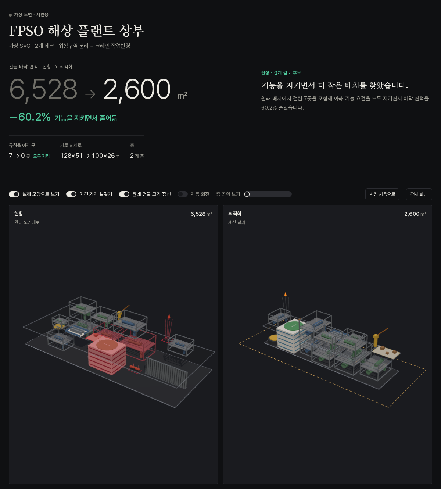

# 결과 상세 — 예제 6건, 실제 도면 시험, 검증 이력

[← README](../README.md) · [구조](ARCHITECTURE.md) · [벤치마크](BENCHMARKS.md) · [한계](LIMITATIONS.md) · [설치·연결](CONNECT.md)

아래 숫자는 전부 [`docs/data.js`](../docs/data.js) (3D 비교 페이지와 같은 데이터, `python3 tools/make_viewer_data.py` 로 생성)
에서 가져왔다. 바닥 면적은 페이지와 같이 정수로 반올림했다.

> **이 개선율을 성과로 쓰지 말 것.** 가상 4건의 현황 도면은 사람이 그렸을 법한 관행 배치(복도형 2열, 파이프랙 양측 배치)를
> **규칙으로 생성한 합성 도면**이고, 관행적 여유 공간을 일부러 담았다. FPSO 의 −60% 같은 숫자는 그 여유 때문이다.
> 병원·실제 도면 2건이 보여주듯 **꽉 찬 평면에서는 솔버가 개선을 지어내지 않는다.**
> 실제 기대치는 기존 연구대로 −10~15% 수준으로 본다.

## 1. 예제 — 합성 도면 4건

`examples/drawings/` — `python3 tools/make_examples.py` 로 다시 만든다. 요건 파일은 좌표 없는 패치다.
탐색량 normal, seed 20260826. 이 표는 **기능 유지 요건을 넣기 전**(면적·안전 규칙만) 결과다.

| 예제 | 형식 | 무엇이 어려운가 | 결과 (면적만) |
|---|---|---|---|
| **원전 보조건물** (가상) 3개 층, 44기기 | DXF (mm) | 화재분리 App.R, 해치 화재구역 병합, 다층 관통(SFP·RWST·해치), 터빈 미사일, 중요구역, 하중경로, 공지, 중력구동 표고, 크레인 | 현황 hard 위반 **15 → 0**, 건축면적 7,569 → 4,994 m² (**−34.0%**) |
| 석유화학 공정 플랜트 (가상) | 벡터 PDF 1:500 | 가열로·압축기·탱크·제어실 화재/폭발 이격, 공정 배관, 고정 파이프랙 | 위반 **7 → 0**, 19,764 → 17,980 m² (**−9.0%**) |
| FPSO 상부 2개 데크 (가상) | SVG | 위험구역↔거주구역 분리, 무게중심 편심, 고정 터렛·크레인 | 위반 **4 → 0**, 6,528 → 3,724 m² (−43.0%) |
| 병원 수술부 (가상) | PNG 래스터 | 청결/오염 분리, 수술실-멸균코어 인접. **현황이 빈틈없이 꽉 찬 평면** | 위반 2 → 1 — **"채택 불가" 판정** (줄일 여지 없음) |

원전 예제의 폭(110 m)이 이 단계에서 줄지 않은 이유는 양 끝 계단 코어를 고정 장애물로 인식했기 때문이다 —
도구가 "정말 고정입니까?" 라고 묻는 이유다. 기능 유지 단계(아래)에서는 코어를 수직 코어로 묶어 움직이게 했다.

## 2. 기능 유지 최적화 (2026-11-01) — 6건

고정을 없애고(계단 코어·배관대·크레인도 이동, 복도·배관대 구간은 삭제 가능) 대신 역할을 제약으로 지킨다 —
실 출입(`CIRC-ACCESS`), 동선 연결(`CIRC-CONNECT`), 피난(`EGRESS`), 배관대·크레인 공급(`RACK-SERVE`),
근거 있는 실 규모 계획(`program`). 요건과 근거: [`examples/function/`](../examples/function/README.md). thorough, seed 20260826.

| 사례 | 바닥 면적 현황 → 최적화 | 변화 | hard 위반 현황 → 최적화 | 판정 |
|---|---|---|---|---|
| 원전 보조건물 (가상 DXF, 3층) | 7,569 → 3,981 m² | −47.4% | 69 → 6 | **채택 불가** — 동선 연결 4 · 외벽 접면 2 남음 |
| 석유화학 플랜트 (가상 PDF) | 19,764 → 5,803 m² | −70.6% | 9 → 0 | 설계 검토 후보 — 단 배관대 30구간 중 24개 삭제, 도로·소방차 접근로 미반영(**과대평가**) |
| FPSO 상부 (가상 SVG, 2데크) | 6,528 → 2,600 m² | −60.2% | 7 → 0 | 설계 검토 후보 |
| 병원 수술부 (가상 PNG) | 2,068 → 2,011 m² | −2.8% | 2 → 2 | **채택 불가** — 청결/오염 복도 분리·멸균 코어 통과 금지까지 넣은 결과 (아래 정정 참고) |
| 의료·치과 클리닉 (**실제** IFC) | 3,430 → 3,386 m² | −1.3% | 3 → 4 | **채택 불가** — 외곽 초과 1 · 동선 연결 3. 현황 유지 |
| 연구소 건물 (**실제** IFC, KIT) | 712 → 665 m² | −6.6% | 0 → 1 | 현재 외곽(41.4×17.2 m)을 넘음 — **현황 유지** |

같은 사례를 **면적만** 보고 줄인 이전 실행과 비교하면:

| 사례 | 현황 위반 (엔진) | 이전 (면적만) | 같은 근사 검사: 현황 → 이전 결과 | 기능 유지 | 남은 위반 |
|---|---|---|---|---|---|
| 원전 보조건물 (가상) | 69 | −34.0% | 60 → 71 | −47.4% | 동선 연결 4 · 외벽 2 |
| FPSO 상부 (가상) | 7 | −43.0% | 2 → 1 | −60.2% | 0 |
| 병원 수술부 (가상) | 2 | −0.4% (위반 1) | 0 → 1 | −2.8% | 2 (채택 불가) |
| 석유화학 플랜트 (가상) | 9 | −9.0% | 3 → 8 | −70.6% | 0 |
| 의료·치과 클리닉 (실제) | 3 | −7.0% | 16 → 60 | −1.3% | 동선 연결 3 · 외곽 초과 1 |
| 연구소 (실제, KIT) | 0 | — | — | −6.6% 이지만 외곽 초과 | 외곽 초과 1 |

- **현황 위반(엔진)** 은 원래 도면을 같은 요건으로 채점한 수다. 가상 원전 예제는 합성 도면의 기기가 복도에 닿지 않아
  현황부터 69건이다 — 그러니 "이전 결과가 기능을 깼다" 는 비교는 **같은 검사로 잰 현황 대비** 로만 읽어야 한다
  (`tools/check_function_rules.py`, 계단 묶기·복도 분할을 하지 않는 근사라 엔진 수치와 다르다). 클리닉은 16 → 60 으로 뚜렷이 나빠졌다.
- 실제 클리닉의 실 면적은 현황에서 겹친 실을 잘라내며 **10.3% 줄어든 상태로** 배치된다 (`_resolve_overlaps`) — 축소율이 그만큼 유리하게 나올 수 있다.
- 2026-11-01 독립 검증에서 나온 문제를 고친 뒤의 수치다: 계단 코어가 경계값에서 묶이지 않던 버그(이전 원전 예제 "위반 0" 은 무효),
  접촉을 유지보수 이격 포함 외곽으로 재던 문제(이제 본체 기준), 수술실이 다른 실을 거쳐 들어가던 문제(`direct`),
  위층 계단이 피난층까지 이어지는지 검사 추가.
- 이전 결과는 안전 이격·화재구역 같은 *안전 규칙* 은 지켰지만 *쓰임새*(출입·동선·피난)는 보지 않았다.
  실제 평면 두 건과 가상 원전 예제는 기능을 지키며 줄이는 해를 아직 찾지 못했다 —
  복잡한 동선망을 다시 짜는 것은 지금 탐색(Sequence-Pair + SA)의 한계다.

## 3. 공개 실제 도면 시험 — 의료·치과 클리닉 (2026-11-01)

가상 예제만으로는 실제 도면에서 어떻게 되는지 알 수 없어서, **실제 건물의 공개 BIM**으로 돌렸다.

- 도면: Medical-Dental Clinic `Clinic_Architectural.ifc` (실제 건물, 정보 일부 비공개 처리) —
  BSI (2020) "Medical-Dental Test Files," buildingSMART International,
  [Community-Sample-Test-Files](https://github.com/buildingsmart-community/Community-Sample-Test-Files), CC BY 4.0.
  파일은 저장소에 넣지 않았다. `bench/real/public/clinic/` 에 받아 두면 `tools/make_viewer_data.py` 가 포함한다.
- 인식: IfcSpace 269개 중 실 259 + 뚫린 공간 1 + 지붕 면 6(제외), 계단 6, 3개 층(빈 기초층 제외). 약 3초.
- 결과(normal, seed 20260826, **요건 없이** 도면만): 바닥 면적 3,430 → 3,189 m² (**−7.0%**), hard 위반 0 —
  **대신 원래 붙어 있던 실들이 멀어졌다 (인접 비용 3.5배).** 인접 가중치를 10배로 올려도 −5.5%, 3.8배.
  엔진은 실을 자유 직사각형으로 보고 전체를 다시 섞으므로 **실제 평면의 동선 구조를 유지하지 못한다.**
  실무에 쓰려면 실 간 인접·동선 요건(어떤 실끼리 붙어야 하는가)을 먼저 정의해야 한다.
- 실제 도면에서 처음 드러나 고친 것: 빈 IFC 층이 1층으로 끼어듦 · 벽의 창/문 구멍이 층 관통 개구부로 잡힘(403개) ·
  ROOF/OPEN TO BELOW 공간이 실과 겹침 · ㄱ·ㄷ자 실의 외접 사각형 합이 바닥 면적을 넘음(→ 같은 면적 직사각형) ·
  벽 두께로 겹친 실들(→ 맞닿은 면에서 잘라 냄, 면적 10.3%) · **현황 → Sequence-Pair 변환이 빽빽한 평면에서
  외피를 52×66 → 73×74 m 로 부풀림**(→ Murata 조건 그대로 구성, 현황보다 커지지 않음을 테스트로 보장).
  마지막 수정으로 가상 원전 예제도 −28.8% → −34.0% 로 바뀌었다.

연구소 건물(KIT `AC20-Institute-Var-2.ifc`, [steptools 공개 샘플](https://downloads.steptools.com/docs/stpfiles/ifc/))은
같은 방법으로 읽었다. 사용 조건은 저장소 소유자가 확인한다 (2026-11-01 기준 공개 샘플 모델).
두 실제 도면 모두 IfcSpace 를 직사각형 블록으로 근사했고 원본 파일은 수정하지 않았다.

### 공개 원전 도면에 대해

NRC 공개 NuScale 문서(FSAR 1장 평면도 24장)에서 실제 평면도를 받아 시험했으나, 층별 배치도는
**비공개 처리(10 CFR 2.390)되었거나 선으로 그린 래스터**여서 CAD 기하가 없었다. 벡터 블록 다이어그램
(기능 경계도)에서는 RXB·CRB·RWB·TGB 건물 경계를 라벨까지 정확히 읽었다. APR1400 DCD 배치도는 전부 삭제본이다.
그래서 원전 사례는 합성 도면뿐이다.

## 4. IR 전용 경로 예제 (`examples/spec_smr_aux.json`, 44블록 · 3층 · seed 20260826)

도면 없이 IR 만으로 돌리는 경로의 예제다 (`python3 engine/run.py examples/spec_smr_aux.json --iters 60000 --restarts 6`).

| 항목 | 기준안(수작업식 행 배치) | 최적화 |
|---|---|---|
| 외피 | 88.0 × 37.0 × 32.0 m | 51.0 × 45.8 × 32.0 m |
| 건축면적 | 3,256 m² | 2,336 m² |
| 건물체적 | 104,192 m³ | 74,746 m³ |
| hard 제약 위반 | 다수 | **0건** |
| 소요 | — | 206 s (60,000 iter × 6 restart) |

> **이 개선율을 성과로 제시하지 말 것.**
> 기준안이 나이브하다 (입력 순서대로 줄 세운 배치). **실제 기대치는 −10~15%** 다.
> 의미 있는 숫자는 개선율이 아니라 **hard 제약 위반 0건** 쪽이다.

음성 대조군 `examples/spec_infeasible.json` 은 실현 불가능한 요구사항 집합에 "불가능"이라고 답하는지 확인한다
(`run.py` 가 종료코드 1 로 거부해야 정상). **LLM 파이프라인은 유창하게 실패한다** — 그래서 이 대조군이 필요하다.

## 정정 — 병원 수술부 동선 (2026-11-02)

이전에 "−12.6%, 위반 0, 설계 검토 후보" 로 보고한 병원 결과는 **수술 동선이 틀린 배치**였다.
이름 규칙이 '대기' 가 들어간 실을 모두 동선(로비)으로 분류해, 수술실 3개가 **수술 전 대기실을 거쳐서만** 드나들었는데도 통과했다.
실을 복도에만 연결하게 고치자 이번에는 회복실이 멸균물품 코어를, 수술 전 대기가 중앙공급실을 지나가는 경로가 나왔고,
오염 처리실이 청결 복도에 붙었다. 그래서 출입 규칙에 두 가지를 더했다:

- `corridor_for` — 수술실·스크럽·마취·멸균 코어·청결 창고는 청결 복도로, 오염 처리실은 일반 복도로만 드나든다 (청결/오염 분리 — 이 구현의 해석)
- `through_ok` — 다른 실이 거쳐 지나가도 되는 실은 스크럽뿐이다 (멸균 공간을 통로로 쓰지 않게)

원래 도면은 이 규칙을 모두 지킨다(남은 위반은 원래 있던 이격 2건). 최적화 결과는 −2.8% 에 위반 2건(오염 처리실 출입 1, 이격 1)으로
채택할 수 없다 — 이미 꽉 찬 평면에서 동선까지 지키면 줄일 여지가 거의 없다. 3D 페이지에서 '문·동선' 을 켜고 실에 마우스를 올리면
복도까지의 경로를 볼 수 있다.
